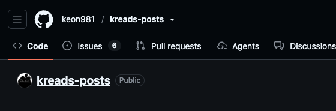
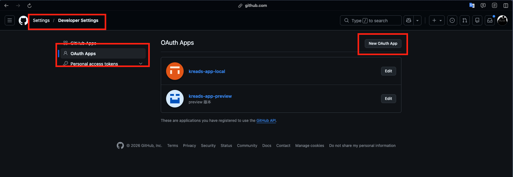

# Kreads

[English](README.md)

以 GitHub Issues 儲存內容的 Threads 風格多人社群平台。

## 🎮 線上體驗

| | 網址 | 說明 |
| --- | --- | --- |
| 🌐 主站 | [kreads-app-virid.vercel.app](https://kreads-app-virid.vercel.app) | 免登入即可瀏覽貼文 |
| 📊 後台 | [kreads-dashboard-app.vercel.app](https://kreads-dashboard-app.vercel.app) | 使用下方遊客帳號登入參觀 |

後台遊客帳號（唯讀）：

- **Email**：`admin@mail.com`
- **密碼**：`123456`

## ✨ 專案介紹

**GitHub Issues** 📝 = 免費、穩定、原生支援 Markdown、留言與表情回應的內容儲存

**Threads** 🧵 = 簡潔的短文社群

**Kreads** 🚀 = 每個人的貼文都存在自己 GitHub repo 的多人社群！

Kreads 的貼文不存在平台的資料庫，而是存在每位使用者自己的 GitHub public repo：Issue 就是貼文、Issue comment 就是留言、Reaction 就是按讚。平台只保存帳號與邀請關係，內容始終屬於使用者自己。

專案以 pnpm monorepo 組成，包含主站與管理後台兩個 Next.js App，共用 UI 元件庫、資料庫 schema 與驗證設定。

## 🚀 亮點功能

1. 📝 以 GitHub Issues 儲存內容
   - 註冊時自動在使用者的 GitHub 帳號建立 public repo，貼文、留言、按讚分別對應 Issue、Comment、Reaction
   - 登入後以使用者自己的 GitHub token 存取 GraphQL API，未登入的訪客也能瀏覽
2. 🎟️ 邀請制註冊
   - 管理員發放的一次性邀請碼
   - 每位使用者都有個人邀請連結，可邀請 3 位朋友加入
3. 💬 社群互動
   - Markdown 編輯器發文，可編輯、刪除
   - 在任何人的貼文留言、按讚
4. 📊 管理後台
   - 儀表板：使用者、邀請碼核銷與登入活動的統計和趨勢圖
   - 使用者管理：封鎖、撤銷登入、刪除、調整權限
   - 邀請碼管理：產生、設定權限、批次刪除
   - 依身分顯示資料：管理員看到完整資料，遊客帳號與未登入訪客只看到公開資料
5. ✨ 使用體驗
   - 響應式設計：桌面版側欄、行動版底部 Tab Bar
   - 淺色／深色主題
   - 骨架屏載入狀態

## 📝 使用說明

### 主站

#### 註冊

1. 開啟朋友分享的邀請連結（已註冊的使用者可以在個人頁點「邀請」複製）
2. 輸入要用來存放貼文的 repo 名稱
3. 透過 GitHub 授權登入
4. Kreads 會在你的 GitHub 帳號下建立這個 public repo（已存在就直接沿用），之後的貼文都存在這裡



> 例如 [keon981/kreads-posts](https://github.com/keon981/kreads-posts/issues)

#### 發文與互動

| Kreads | GitHub |
| --- | --- |
| 發文 | 在你的 repo 建立 Issue |
| 編輯貼文 | 更新 Issue 內容 |
| 刪除貼文 | 關閉 Issue |
| 留言 | 以你的帳號在 Issue 下留言 |
| 按讚 | 對 Issue 或留言加上 ❤️ Reaction |

在設定選單可以切換「公開／隱私」，決定是否出現在後台的公開使用者列表。

### 後台

使用[線上體驗](#-線上體驗)的遊客帳號登入後，可以瀏覽：

| 頁面 | 管理員 | 遊客帳號 |
| --- | --- | --- |
| 儀表板 | 完整統計卡、趨勢圖與最近活動 | 公開統計卡 |
| 使用者 | 所有使用者，可封鎖、撤銷登入、刪除、調整權限 | 管理員與設為公開的使用者 |
| 邀請碼 | 所有邀請碼，可產生、設定權限、刪除 | 已核銷的邀請碼（部分遮蔽） |

## 🛠️ 技術棧

- **框架**：Next.js 16（App Router、Cache Components）+ React 19 + TypeScript
- **驗證**：better-auth（GitHub OAuth、Email／密碼登入、角色權限）
- **資料庫**：Neon Postgres + Drizzle ORM
- **GitHub API**：Octokit（REST + GraphQL）
- **資料請求**：TanStack Query
- **狀態管理**：Zustand
- **UI**：shadcn/ui（Base UI）+ Tailwind CSS 4 + Remix Icon
- **編輯器**：Tiptap（Markdown）
- **表格與圖表**：TanStack Table、Recharts
- **資料驗證**：Zod
- **Monorepo**：pnpm workspace + Vite+
- **元件開發**：Storybook
- **程式碼規範**：ESLint（@antfu/eslint-config）
- **部署**：Vercel

```text
kreads-app/
├── apps/
│   ├── web/                    # 主站
│   │   ├── app/                # 路由：個人頁、貼文頁、登入／註冊、API
│   │   ├── components/         # 貼文、驗證、版面元件
│   │   ├── services/github/    # GitHub Issues、Comments、Reactions
│   │   ├── views/              # 頁面元件
│   │   └── proxy.ts            # 登入保護、附加 GitHub token
│   └── dashboard/              # 管理後台
│       ├── app/(pages)/        # 儀表板、使用者、邀請碼、個人設定
│       └── components/         # 資料表格、統計卡片、版面元件
├── packages/
│   ├── ui/                     # 共用 UI 元件庫（shadcn/ui）與 Storybook
│   ├── server/                 # 共用資料庫 schema、migrations、驗證設定
│   ├── eslint-config/          # 共用 ESLint 設定
│   └── typescript-config/      # 共用 tsconfig
└── docs/                       # README 圖片
```

## 📦 安裝與使用

### 環境需求

- Node.js 22+
- pnpm 11+ 與 [Vite+](https://viteplus.dev/guide/)（`vp` 指令）
- [Neon](https://neon.com/) Postgres 資料庫

### 1. 建立 GitHub OAuth App

1. 前往 [GitHub Settings > Developer settings > OAuth Apps](https://github.com/settings/developers)，點擊「New OAuth App」

   

2. 填寫應用資訊：
   - **Application name**：Kreads
   - **Homepage URL**：`http://localhost:3000`
   - **Authorization callback URL**：`http://localhost:3000/api/auth/callback/github`
3. 建立後取得 `Client ID`，並產生 `Client Secret`

> 一個 OAuth App 只能設定一組 callback URL，本機與部署環境需要各建立一個，例如圖中的 `kreads-app-local` 與 `kreads-app-preview`。

### 2. 安裝與設定

```bash
git clone https://github.com/keon981/kreads-app.git
cd kreads-app
vp install

cp apps/web/.env.example apps/web/.env
cp apps/dashboard/.env.example apps/dashboard/.env
cp packages/server/.env.example packages/server/.env
```

依照各 `.env` 檔案中的註解，填入 GitHub OAuth App 與資料庫連線資訊。

### 3. 啟動

```bash
vp run drizzle:migrate   # 建立資料表
vp run dev               # 主站 http://localhost:3000、後台 http://localhost:3001
```

---

<div align="center">

Made with ❤️ by [keon981](https://github.com/keon981)

</div>
