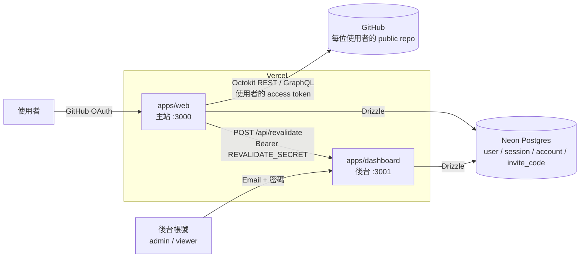
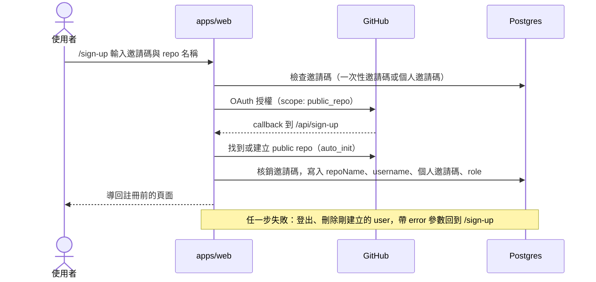

# Kreads

以 **GitHub Issues 當資料庫** 的 Threads 風格社群。每位使用者的貼文都存在自己的 GitHub public repo 裡，主站只負責呈現與操作；帳號、邀請碼與統計則存在 Postgres，由獨立的後台管理。

| 社群概念 | 對應到 GitHub |
| --- | --- |
| 個人頁 `/@<login>` | 使用者註冊時綁定的 public repo |
| 貼文 | repo 擁有者開的 open Issue（標題為建立時間戳，內文為貼文內容） |
| 刪除貼文 | 關閉 Issue |
| 留言 | Issue comment |
| 按讚 | Issue / comment reaction（種類由 `REACTION_EMOJI` 決定） |

## 功能

**主站 `apps/web`**

- GitHub OAuth 登入；**邀請制註冊**，註冊時自動找到或建立指定名稱的 public repo
- 發文、編輯、刪除、留言、按讚（Tiptap Markdown 編輯器）
- 每位使用者有一組個人邀請碼，一般使用者最多邀請 `INVITE_LIMIT` 人，admin 不限
- 「公開／隱私」設定：只影響使用者是否出現在後台的公開列表，主站個人頁不受影響
- 未登入可瀏覽；未登入時以 GitHub REST 匿名讀取（受 GitHub 匿名 rate limit 限制），登入後改用使用者 token 走 GraphQL
- 淺色／深色主題、桌面側欄＋行動版底部 Tab Bar

**後台 `apps/dashboard`**（版面參考 New API）

- 儀表板：註冊、邀請碼核銷、登入活動的統計卡與趨勢圖
- 使用者管理：封鎖／解封、撤銷 session、刪除、調整分組（user / admin）
- 邀請碼管理：產生一次性邀請碼、設定核銷後的分組、批次刪除未使用的邀請碼
- 個人設定：變更登入 Email 與密碼
- 除了個人設定頁，後台對未登入訪客也開放唯讀瀏覽（見 [角色與權限](#角色與權限)）

## 架構



- 兩個 App 共用同一個資料庫與 `@workspace/server` 的 better-auth 設定，但各自有獨立的 `BETTER_AUTH_SECRET`；後台的 cookie 加上 `kreads-dashboard` 前綴，避免本機同為 `localhost` 時互相覆蓋
- 後台以 tag 快取訪客與 viewer 看到的資料；主站在使用者切換公開設定、或新的 admin 註冊時，透過 `/api/revalidate` 通知後台清快取。後台同步失敗時，主站會把公開設定改回原值
- 主站 `proxy.ts` 在每個請求把 GitHub access token 放進內部 header（並先刪掉外部傳入的同名 header），cookie 裡沒有可用的 token 時，再透過 better-auth 重新取得

### 註冊流程



已經有 GitHub 帳號但沒完成註冊的人無法直接登入（`disableImplicitSignUp`），一定要經過邀請碼流程。

## 技術棧

| 類別 | 使用 |
| --- | --- |
| 框架 | Next.js 16（App Router、Cache Components、`proxy.ts`）、React 19 |
| 驗證 | better-auth（GitHub OAuth、Email + 密碼、admin plugin 與自訂角色） |
| 資料庫 | Neon Postgres（serverless HTTP driver）、Drizzle ORM / drizzle-kit |
| GitHub | `@octokit/rest`（REST + GraphQL） |
| 狀態與資料 | TanStack Query（主站）、TanStack Table（後台）、Zustand |
| UI | shadcn（Base UI）、Tailwind CSS 4、Remix Icon、Tiptap、Recharts |
| 環境變數 | `@t3-oss/env-nextjs` + Zod 4 |
| 工具 | pnpm workspace、[Vite+](https://viteplus.dev/)（`vp`）、ESLint（`@antfu/eslint-config`）、Storybook |

## 專案結構

```text
kreads-app/
├── apps/
│   ├── web/                 # 主站（port 3000）
│   │   ├── app/
│   │   │   ├── (pages)/     # 首頁、/@<login>、貼文頁、(private)/profile
│   │   │   ├── (blank)/     # sign-in、sign-up
│   │   │   ├── api/         # better-auth、sign-up callback、posts / comments
│   │   │   └── server/      # Server Actions、DB 查詢、通知後台
│   │   ├── services/github/ # Issues、comments、reactions、repo
│   │   ├── views/           # 頁面層級元件
│   │   └── proxy.ts         # 私人頁導向、附加 GitHub token
│   └── dashboard/           # 後台（port 3001）
│       ├── app/(pages)/     # dashboard、user、key、profile
│       └── app/api/revalidate/
└── packages/
    ├── server/              # @workspace/server：Drizzle schema 與 client、better-auth 共用設定、共用型別
    │   └── drizzle/         # migrations
    ├── ui/                  # @workspace/ui：shadcn 元件、hooks、globals.css；stories/ 給 Storybook
    ├── eslint-config/       # @workspace/eslint-config
    └── typescript-config/   # @workspace/typescript-config
```

## 開始使用

### 1. 環境需求

- Node.js 22
- [Vite+](https://viteplus.dev/guide/)：提供 `vp` 指令，本專案只用它當套件管理與 script runner
- pnpm 11 以上（`package.json` 的 `devEngines` 會在版本不符時自動下載）
- 一個 [Neon](https://neon.com/) Postgres 資料庫
- 一個 GitHub OAuth App：GitHub → Settings → Developer settings → OAuth Apps，Authorization callback URL 填 `http://localhost:3000/api/auth/callback/github`

### 2. 安裝與設定

```bash
vp install

cp apps/web/.env.example apps/web/.env
cp apps/dashboard/.env.example apps/dashboard/.env
cp packages/server/.env.example packages/server/.env
```

三份 `.env` 的 `DATABASE_URL` 都填同一個資料庫，`REVALIDATE_SECRET` 主站與後台填同一組，`BETTER_AUTH_SECRET` 兩個 App 各自產生：

```bash
openssl rand -base64 32   # BETTER_AUTH_SECRET（web、dashboard 各一組）
openssl rand -hex 32      # REVALIDATE_SECRET（web、dashboard 共用）
```

<details>
<summary><b>apps/web/.env</b></summary>

| 變數 | 必填 | 說明 |
| --- | --- | --- |
| `NEXT_PUBLIC_HOME_USERNAME` | ✓ | 首頁 `/` 要導向的使用者，格式 `@<GitHub login>`；空字串時 `/` 不導向（目前是佔位頁） |
| `NEXT_PUBLIC_APP_TITLE` | ✓ | 網站標題 |
| `BETTER_AUTH_SECRET` | ✓ | 開發環境沒設會用內建預設值，production 沒設會直接 throw |
| `BETTER_AUTH_URL` |  | App 的 base URL，本機為 `http://localhost:3000` |
| `GITHUB_CLIENT_ID` / `GITHUB_CLIENT_SECRET` | ✓ | GitHub OAuth App |
| `DATABASE_URL` | ✓ | Neon 連線字串 |
| `DASHBOARD_URL` | ✓ | 後台網址，用來通知後台清快取 |
| `REVALIDATE_SECRET` | ✓ | 至少 32 字元，與後台相同 |
| `INVITE_LIMIT` |  | 一般使用者的個人邀請碼可邀請人數，預設 `3` |
| `POST_PREFETCH_LIMIT` |  | 首頁使用者（`NEXT_PUBLIC_HOME_USERNAME`）的個人頁載入時，預取前幾則貼文頁，預設 `5` |
| `REACTION_EMOJI` |  | 按讚使用的 reaction：`laugh`、`confused`、`heart`、`hooray`、`rocket`、`eyes`，預設 `heart` |
| `DEV_ALLOWED_ORIGINS` |  | 開發時允許的來源（JSON 陣列），例如用手機連區網測試 |

</details>

<details>
<summary><b>apps/dashboard/.env</b></summary>

| 變數 | 必填 | 說明 |
| --- | --- | --- |
| `NEXT_PUBLIC_APP_TITLE` |  | 後台標題，預設 `Kreads Dashboard` |
| `BETTER_AUTH_SECRET` | ✓ | 與主站不同的一組 |
| `BETTER_AUTH_URL` |  | 本機為 `http://localhost:3001` |
| `DATABASE_URL` | ✓ | 與主站相同 |
| `REVALIDATE_SECRET` | ✓ | 與主站相同 |

</details>

<details>
<summary><b>packages/server/.env</b></summary>

| 變數 | 必填 | 說明 |
| --- | --- | --- |
| `DATABASE_URL` | ✓ | 給 drizzle-kit（`drizzle:generate`、`drizzle:migrate`）使用，與兩個 App 相同 |

</details>

### 3. 建立資料表並啟動

```bash
vp run drizzle:migrate   # 套用 packages/server/drizzle 的 migrations
vp run dev               # 同時啟動主站 http://localhost:3000 與後台 http://localhost:3001
```

### 4. 建立第一批帳號

註冊需要邀請碼，邀請碼由後台 admin 產生，因此初始化順序是：

1. **建立後台 admin 帳號**：後台關閉了註冊（`disableSignUp`），專案目前也沒有 seed script，第一個 Email + 密碼帳號需要自行寫入資料庫，並把 `user.role` 設為 `admin`
2. **產生邀請碼**：登入後台 → 邀請碼頁面產生一次性邀請碼；分組設為 admin 時，核銷者會成為主站 admin（個人邀請碼不限次數）
3. **註冊主站**：開啟 `http://localhost:3000/sign-up?aff=<邀請碼>`，輸入 repo 名稱並完成 GitHub 授權
4. 之後的使用者可以用其他人的個人邀請碼註冊

## 角色與權限

角色定義在 `packages/server/src/auth/access.ts`。

| 身分 | 來源 | 主站 | 後台 |
| --- | --- | --- | --- |
| `user` | 一次性邀請碼、他人的個人邀請碼 | 發文、留言、按讚；個人邀請碼上限 `INVITE_LIMIT` 人 | 無法登入 |
| `admin`（主站使用者） | 分組為 admin 的一次性邀請碼，或由後台調整 | 同 user，個人邀請碼不限次數；admin plugin 的 API 在主站關閉 | 無法登入（後台只接受 Email + 密碼） |
| `admin`（後台帳號） | 手動建立 | — | 看到所有主站使用者與完整統計；可執行所有寫入操作 |
| `viewer` | 手動建立，作為公開的唯讀帳號 | — | 只看到主站 admin 與「公開」的使用者；不能修改任何資料或帳號設定 |
| 訪客（未登入） | — | 瀏覽個人頁與貼文 | 只看到主站 admin 與公開統計卡；個人設定頁需要登入 |

## 常用指令

根目錄 scripts 一律透過 `vp run <script>` 執行：

| 指令 | 說明 |
| --- | --- |
| `vp run dev` | 同時啟動 `apps/*` 所有 App，輸出前綴 `[套件#dev]` |
| `vp run dev:web` / `vp run dev:dashboard` | 只啟動單一 App |
| `vp run storybook` | 在 `@workspace/ui` 啟動 Storybook（http://localhost:6006） |
| `vp run build` | 建置所有 workspace |
| `vp run lint` / `vp run lint:fix` | ESLint 檢查／自動修正（也負責格式化，不使用 Prettier） |
| `vp run typecheck` | 所有 workspace 的型別檢查 |
| `vp run drizzle:generate` | 依 `packages/server/src/db/schema` 產生 migration |
| `vp run drizzle:migrate` | 套用 migration |
| `vp run <套件名稱>#<script>` | 只在單一 workspace 執行，例如 `vp run web#build` |

> 不要執行 `vp check`、`vp test`、`vp fmt`、`vp lint`：本專案沒有安裝 Vitest、Oxlint、Oxfmt，`vp check --fix` 會用 oxfmt 重排整個專案。

## 開發慣例

- **新增 shadcn 元件**：在 `apps/web` 執行 `vp dlx shadcn@latest add <元件>`，元件會裝到 `packages/ui/src/components`
- **元件放哪裡**：不依賴主站的元件、hooks、工具函式放 `packages/ui`；業務相關的（例如 `issue-item`、`use-auth-guard`）留在 App 內
- **Stories**：放在 `packages/ui/stories/`，不放進 `src/`
- **改 DB schema**：修改 `packages/server/src/db/schema` 後執行 `vp run drizzle:generate`，並提交產生的 migration
- **typecheck 錯誤只出現在 `.next/types/`**：那是過期產物，在 `apps/web` 執行 `vp exec next typegen` 後重跑
- **送出前**：`vp run lint:fix` 與 `vp run typecheck` 必須乾淨
- 給 AI agent 的完整規範見 [`AGENTS.md`](./AGENTS.md)

## 部署

主站與後台是兩個獨立的 Vercel 專案：

| 專案 | Root Directory | Build Command |
| --- | --- | --- |
| 主站 | `apps/web` | `next build` |
| 後台 | `apps/dashboard` | `next build` |

- Vercel 只會在 Root Directory 執行 App 自己的 script，而且環境裡沒有 `vp`，所以各 App 的 `build` script 必須維持原生的 `next build`
- 主站的 `apps/web/vercel.json` 只讓 `main` 與 `develop` 分支自動部署
- 兩個專案各自設定上面的環境變數；主站的 `DASHBOARD_URL` 指向後台的正式網址
- GitHub OAuth App 的 callback URL 改成正式網域：`https://<主站網域>/api/auth/callback/github`
- better-auth 的 `baseURL` 會從 Vercel 系統變數（`VERCEL_PROJECT_PRODUCTION_URL`、`VERCEL_BRANCH_URL`、`VERCEL_URL`）建立允許的 host 清單，部署後不接受 `localhost`
